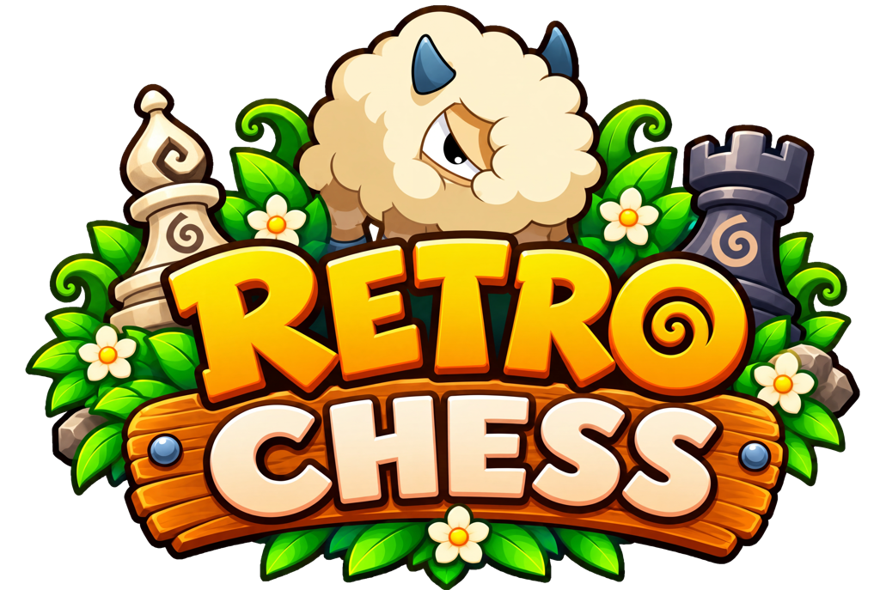
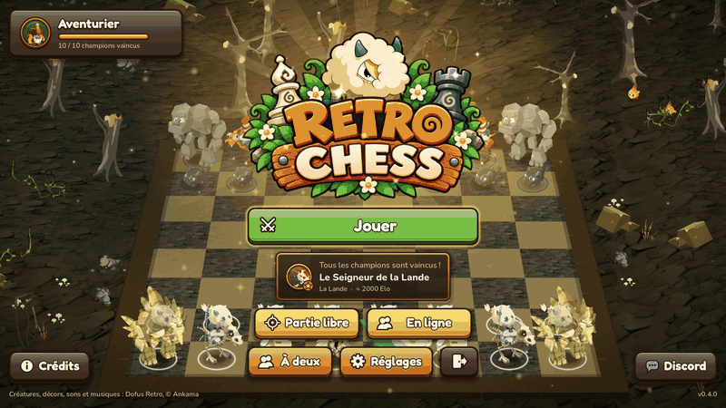

  

  <b>Chess, with living pieces.</b> 
  Every piece is a creature that walks, fights and falls on illustrated boards, 
  against ten champions from 600 to 2000 Elo.

  
  
  
   
  

  

  

---

## ✨ Features

- **The Champions' Path:** ten opponents, one per board, from a 600 Elo beginner to a 2000 Elo master, each with a character of their own.
- **Opponents that look at the board:** the weak champions don't play random moves. They take a piece you leave and rarely give theirs away; they lose on plans, placement and tactics two moves deep. From 1350 Elo, Stockfish's own limited-strength mode takes over ([how it works](docs/HUMAN_AI.md)).
- **Free play:** from the start, pick any board and any strength from 600 to 2800 Elo.
- **Online games:** create a game, share its six-letter code with a friend, and play at a distance (Windows, Android and browser together). No clock, rematches with colours swapped, and a dropped connection comes back on its own.
- **Ten boards** with their own scenery, ambient life and music, from sunny meadows to frozen tundra.
- **Animated armies:** the Bouftou Royal, the Tofu Royal and their friends against Brumaire, Jiva la Sage and the Pandawa Ivre. Every move is a walk, every capture a fight, and resting the mouse on a piece tells its name.
- **Look closer:** zoom and pan around the board, hold the right mouse button and drag up to stand up and look down on it, or press the view button (V) to go from seated to leaning to standing, so no piece hides behind another.
- **Two players on one screen**, and up to five player profiles per device, each with its own progress and portrait.
- **Three sets of pieces**, if you prefer chess pieces to creatures: Bonta against Brâkmar (angels against demons, hand-drawn in the same style) or classic ivory and ebony Staunton pieces, each with its own little animations. Switch at any time with the three buttons at the bottom right of every game, or in the settings.
- **A real engine:** Stockfish runs inside the game, on every platform, including the browser version.
- **English and French**, mouse, keyboard or touch, an animated glove cursor in four sizes, F11 for full screen, a frame-rate cap that saves battery, and in the browser the same full-size pictures as on Windows, drawn at your screen's resolution, full screen with F11, and a performance mode for modest computers.

## 💾 Install

| Platform | How |
| --- | --- |
| **Browser** | Open [retro-chess.holy-c.men](https://retro-chess.holy-c.men/). Nothing to install; always the latest version. |
| **Windows** | Download `RetroChess-windows.zip` from the [latest release](https://github.com/BigFatDeuce/retro-chess-game/releases/latest), unzip it into a folder and run `RetroChess.exe`. |
| **Android** | Download `RetroChess-android.apk` on your phone and open it (allow installs from your browser when asked). Android 7 or later, 64-bit. |

## 🔄 Updates

The Windows and Android versions check this page at launch. When a new version is out, the title screen offers it:
on Windows the game downloads it, closes, installs it and starts again by itself; on Android the system installer
opens with the new version. The check can be turned off in the settings.

## 🧠 Source code

All of the game's code is here: the game itself (Godot 4, GDScript), the tools that build its pictures and sounds,
the chess engine extension and the human-like opponents.

- **Human-like opponents:** [docs/HUMAN_AI.md](docs/HUMAN_AI.md) explains how they were made and measured, and how to
  reuse them with any UCI engine.
- **Building the game:** the creatures, scenery, sounds and music are not in this repository (they belong to Ankama).
  The tools in `tools/` rebuild them from a Dofus Retro install. The engine extension is built from
  [native/](native/README.md).

## 📜 Credits and licence

Retro Chess is a free fan game with no commercial aim, not affiliated with Ankama. Thank you to everyone whose work it
stands on: **[CREDITS.md](CREDITS.md)**.

- Creatures, scenery, sounds and music: [Dofus Retro](https://www.dofus-retro.com/), © Ankama. They are not covered by
  this repository's licence.
- Opponents: [Stockfish 11](https://stockfishchess.org/) (GPLv3), with the [Lichess](https://lichess.org/) open database as
  a reference.
- Made with [Godot Engine](https://godotengine.org/) (MIT).

The game's own code is under the **MIT licence**: reuse it freely, crediting "Retro Chess by BigFatDeuce" with a link
to this page. Stockfish and the engine extension are GPLv3 ([LICENSE](LICENSE)).
