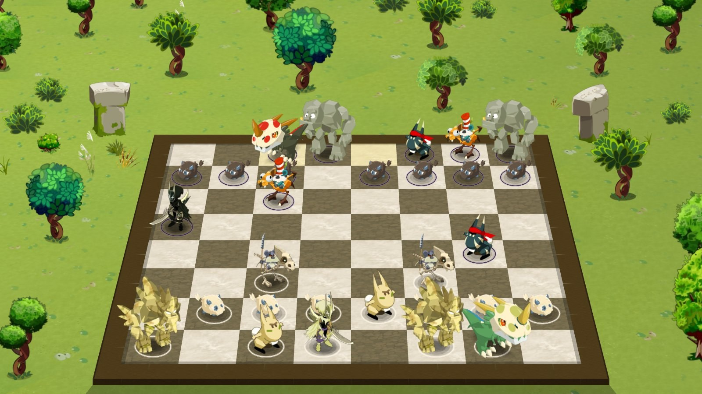

  

  <b>Chess, with living pieces.</b> 
  Every piece is a creature that walks, fights and falls on illustrated boards, 
  against ten champions from 450 to 1900 Elo.

  
  
  
   
  

  

---

## ✨ Features

- **The Champions' Path:** ten opponents, one per board, from a beginner who barely knows the rules to a 1900 Elo master. Each Elo was measured against a calibrated engine.
- **Free play:** from the start, pick any board and any strength from 400 to 2800 Elo.
- **Online games:** create a game, share its six-letter code with a friend, and play at a distance (Windows, Android and browser together). No clock, rematches with colours swapped, and a dropped connection comes back on its own.
- **Ten boards** with their own scenery, ambient life and music, from sunny meadows to frozen tundra.
- **Animated armies:** every move is a walk, every capture a fight, with ranged pieces that shoot from afar.
- **Two players on one screen**, and up to five player profiles per device, each with its own progress and portrait.
- **Classic pieces** if you prefer them: a hand-drawn Staunton set in the same style, with its own little animations.
- **A real engine:** Stockfish runs inside the game, on every platform, including the browser version.
- **English and French**, mouse, keyboard or touch, a frame-rate cap that saves battery, and in the browser a resolution choice (up to 1080p) and a performance mode for modest computers.

## 💾 Install

| Platform | How |
| --- | --- |
| **Browser** | Open [retro-chess.holy-c.men](https://retro-chess.holy-c.men/). Nothing to install; always the latest version. |
| **Windows** | Download `RetroChess-windows.zip` from the [latest release](https://github.com/BigFatDeuce/retro-chess-game/releases/latest), unzip it into a folder and run `RetroChess.exe`. |
| **Android** | Download `RetroChess-android.apk` on your phone and open it (allow installs from your browser when asked). Android 7 or later, 64-bit. |

## 🔄 Updates

The Windows and Android versions check this page at launch. When a new version is out, the title screen offers it:
on Windows the game downloads it, closes, installs it and starts again by itself; on Android the system installer
opens with the new version. The check can be turned off in the settings.

## 📜 Licence

Retro Chess uses [Stockfish 11](https://stockfishchess.org/) (GPLv3) for its opponents. The source code of the engine
as built into the game (Windows, Android and WebAssembly) is attached to every release as
`RetroChess-engine-source.zip`.

Made with [Godot Engine](https://godotengine.org/) (MIT).
